<div align="center">


# Finarez

**Maneja tus finanzas como un pro.** Personal finance for Colombia and México, in Spanish.

[**Open finarez.app →**](https://finarez.app)

[Highlights](#highlights) · [Screenshots](#screenshots) · [Features](#features) · [How it works](#how-it-works) · [Engineering](#engineering) · [Status](#status-and-roadmap) · [Credits](#credits) · [License](#license)

[](https://finarez.app)


<br>


</div>

Finarez keeps accounts, income and expenses, transfers, budgets, savings goals, debts, investments and net worth in one place, with exact money in every currency it supports (COP, MXN, USD and EUR). It is a public, multi-user web app that installs on a phone like a native one, and each person's data is isolated in the database itself, not only in the code. It is live at [finarez.app](https://finarez.app), free to start, and still in active development.

<p align="center">
  <a href="https://finarez.app">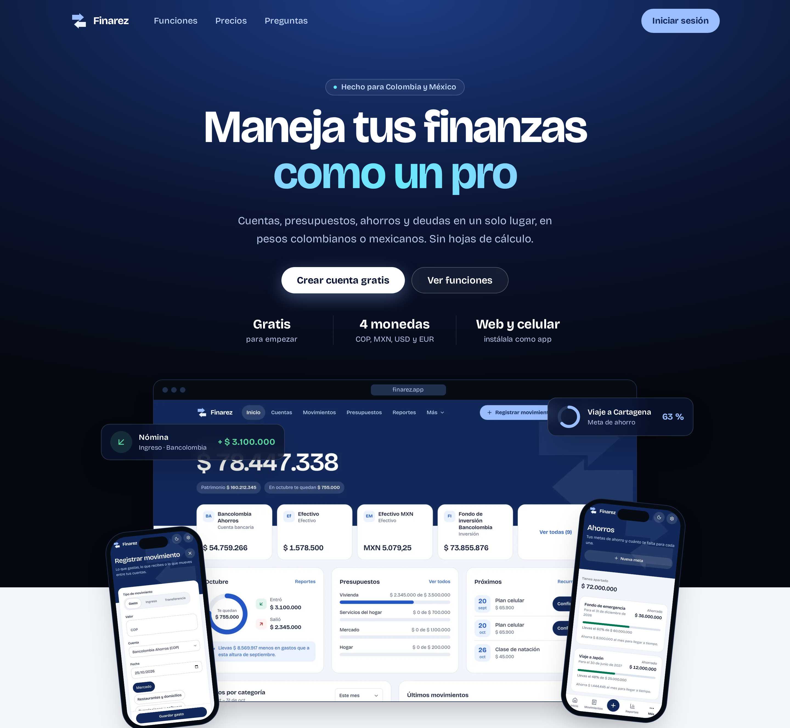</a>
</p>

<p align="center">
  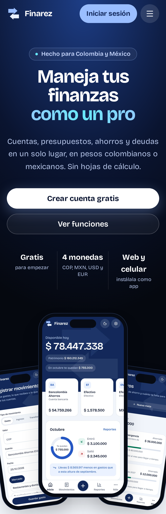
  &nbsp;
  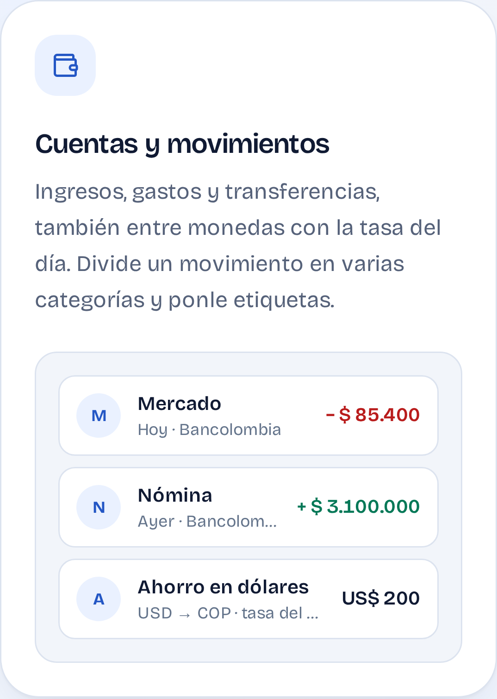
  &nbsp;
  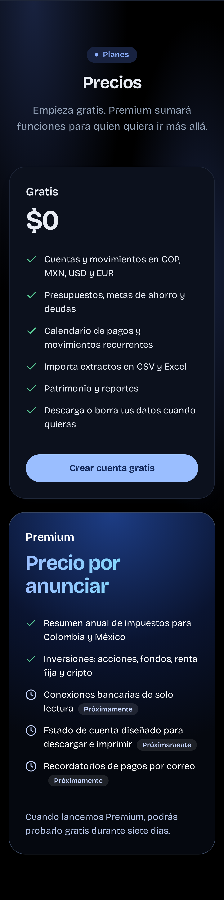
</p>

## Highlights

- **Made for Colombia and México:** pesos colombianos and mexicanos first, dollars and euros too, transfers between currencies at the day's rate, and annual tax summaries for the DIAN and the SAT.
- **No bank password, ever:** import your bank's statement as CSV or Excel and review every row before it is saved.
- **Money that adds up to the cent:** an internal double-entry ledger with integer minor units; no floating point ever touches an amount.
- **Private by design:** each person's rows are protected by PostgreSQL row-level security, behind a strict Content-Security-Policy and optional two-step verification.
- **Web and phone:** one app for the browser and the home screen, in light and dark themes.

## Screenshots

### The homepage

<p align="center">
  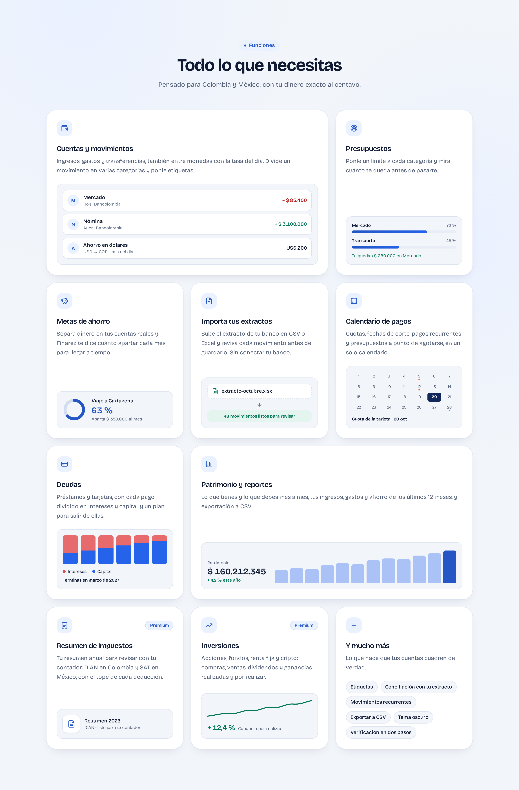
</p>

<p align="center">
  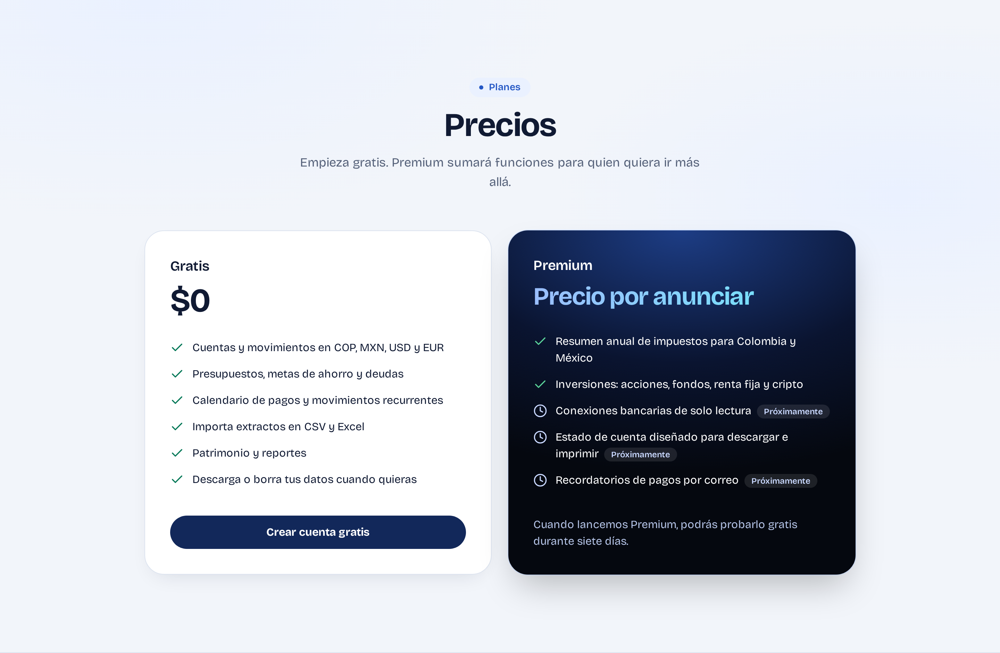
</p>

### Inside the app

<p align="center">
  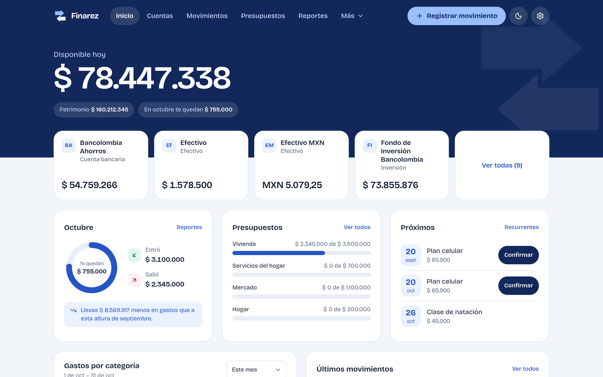
</p>

<table>
  <tr>
    <td width="50%">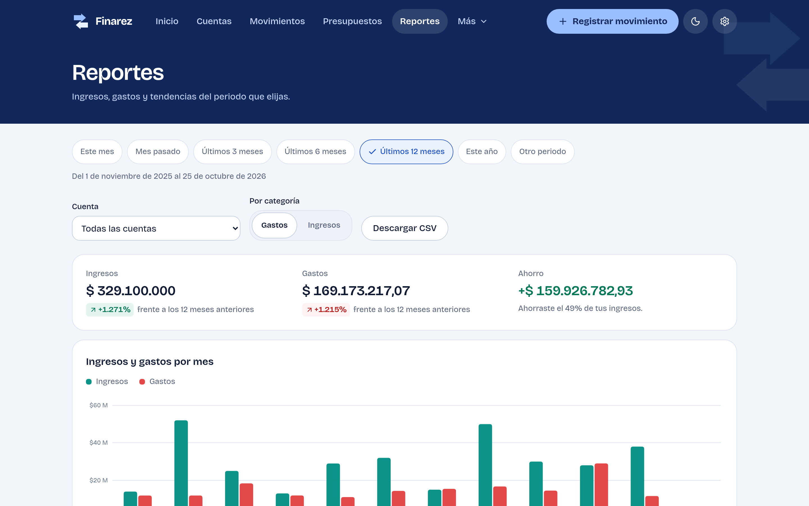</td>
    <td width="50%">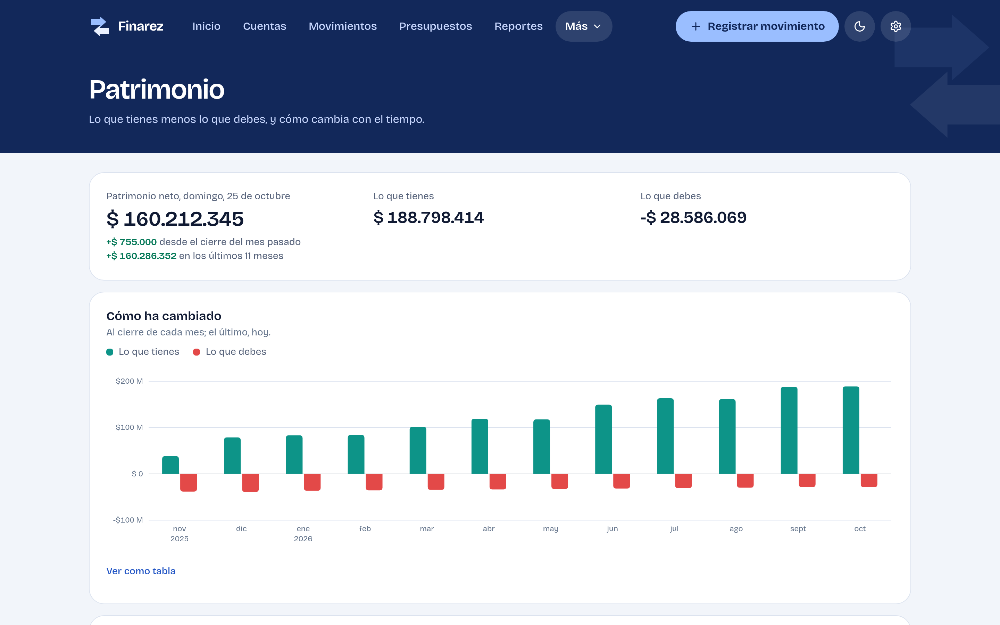</td>
  </tr>
  <tr>
    <td>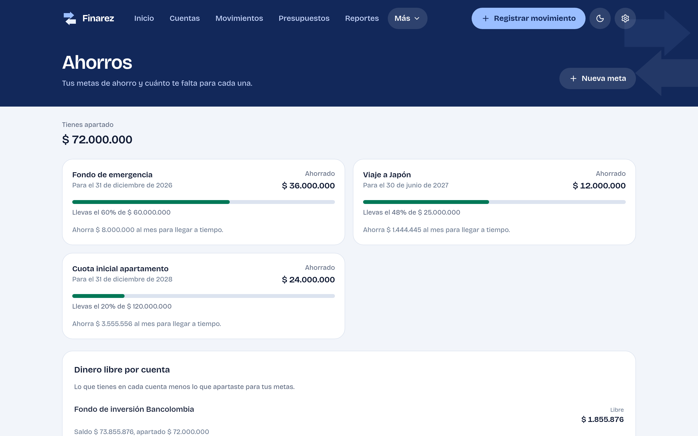</td>
    <td>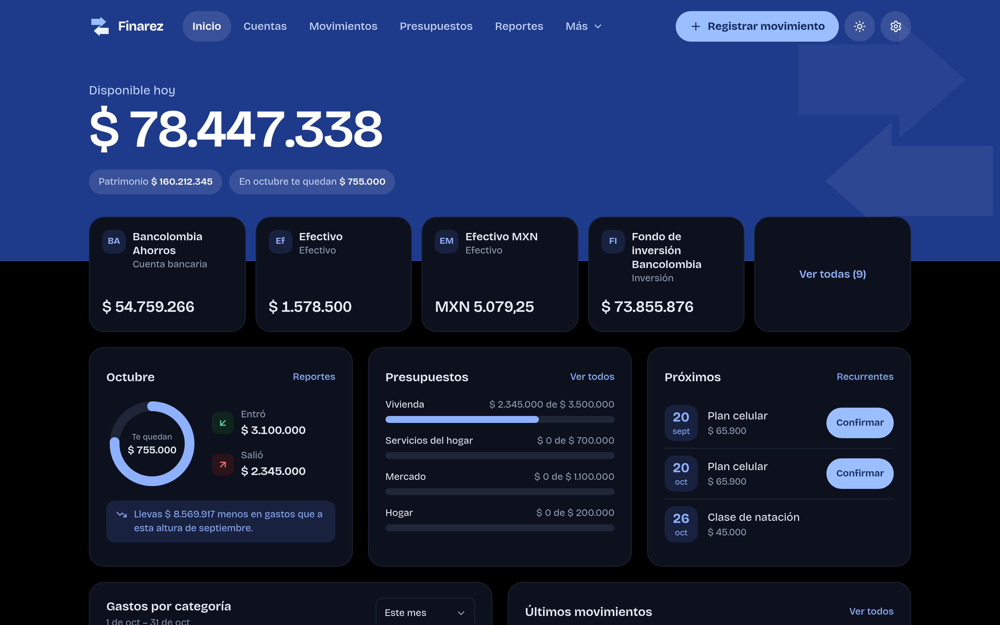</td>
  </tr>
</table>

<p align="center">
  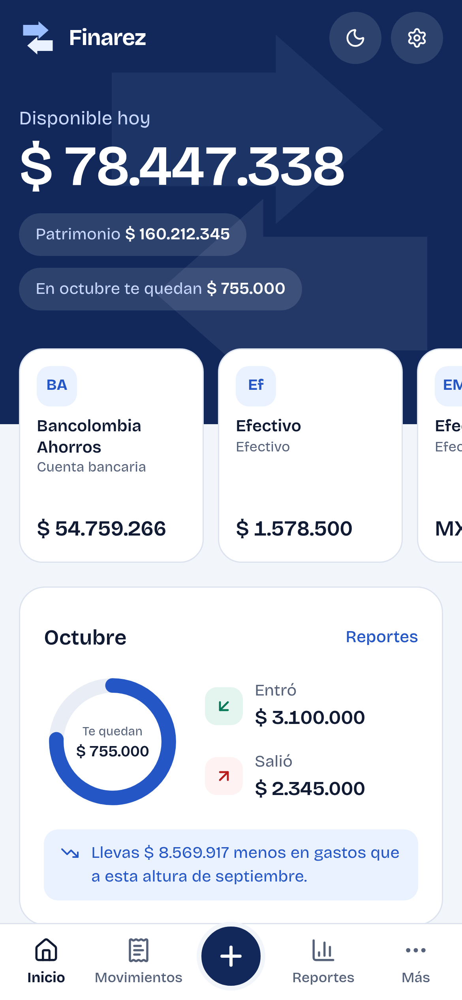
  &nbsp;
  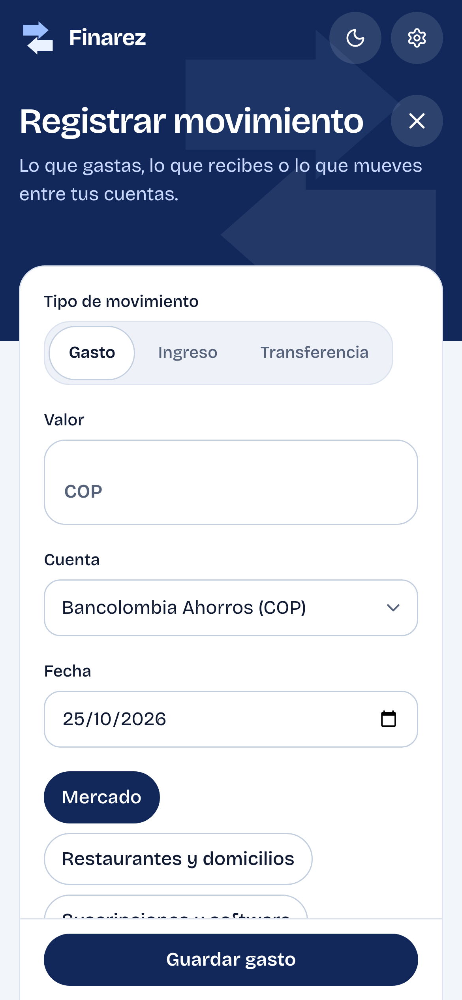
  &nbsp;
  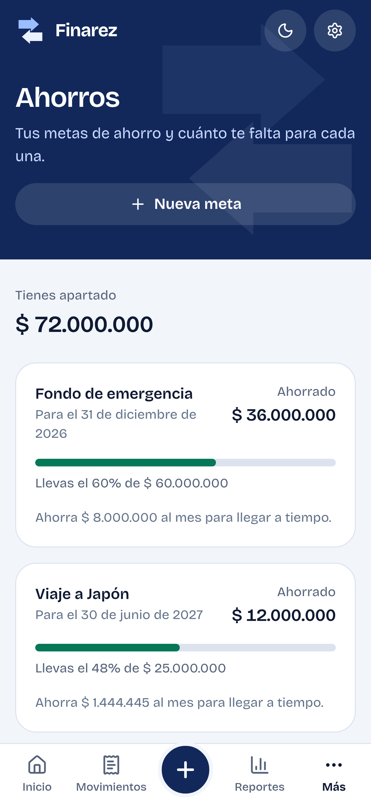
</p>

<sub>Screenshots of the app with a synthetic demo year (no real person's data); the figures on the homepage's feature cards are illustrations.</sub>

## Features

**Day to day**
- **Accounts and movements:** bank accounts, cash, wallets, investments and credit cards; income, expenses and transfers, including between currencies with the day's exchange rate. A movement can be split across several categories and tagged; the description is optional, and a movement that looks already recorded asks before saving.
- **Bank statement import** from CSV, XLSX and XLSM, with a review step before anything is saved.
- **Reconciliation:** check an account against a bank statement's closing balance, with an explicit adjustment for any difference, and undo it.
- **Home dashboard:** what is available today, net worth, the month's income and expenses, budgets and upcoming payments.

**Planning**
- **Budgets** per category and period, and **savings goals** that earmark money in real accounts, record the interest they earn and say how much to set aside each month.
- **Debts:** loans and credit cards, each payment split into interest and principal, and a payoff planner.
- **Recurring movements** and a **payment calendar** of what is coming: debt payments, card cut-offs, recurring items and budgets near their limit.

**Analysis**
- **Reports** and **net worth** over time, with CSV export; Patrimonio shows liquidity (months of spending covered), what you own by type and how much changed in value.
- **Investments (Premium):** holdings in investment accounts (stocks and ETFs, funds, fixed income, crypto), buys, typed prices, FIFO sales with realized and unrealized gains kept apart, and dividends.
- **Annual tax summaries (Premium)** for Colombia (DIAN) and México (SAT, with each personal deduction's own cap and the general one): reviewed figures for an accountant, not a tax return.

**Your account**
- **Your data:** a full export as CSV files in a ZIP, and account deletion with the password.
- **Sign-in** with email verification and optional two-step verification (authenticator app and backup codes).
- **Country of residence at sign-up** with the legal texts and consent of that country.
- Light and dark themes, installable as an app on phones, Spanish first.

## How it works

```text
             browser (React app, installable)
                         │  https://finarez.app
                         ▼
   ┌───────────── Cloudflare Worker "finarez" ─────────────┐
   │  static files (web app) with security headers         │
   │  /api/*  ──►  Hono API, per-request DB connection     │
   │  Cron Trigger  ──►  daily jobs                        │
   └──────────────┬──────────────────────────┬─────────────┘
                  │ Hyperdrive               │ HTTPS
                  ▼                          ▼
        Neon PostgreSQL 18              Resend (email)
        row-level security
```

The public homepage, the sign-in pages and the app are one React application served by the same Worker: `finarez.app` is the homepage, `/dashboard` is the app's start, and the installed app opens straight on the dashboard.

## Engineering

- **One TypeScript monorepo:** a Hono API, a React and Vite web app, and shared packages for money and dates, request schemas and statement parsers.
- **An internal double-entry ledger:** every movement is a set of entries that balance to zero, so reports and balances derive from entries, never from a movement's label.
- **Exact money:** amounts are integer minor units plus a currency, and decimal strings on the wire.
- **Tenant isolation twice:** every query filters by the signed-in user, and PostgreSQL row-level security refuses another user's rows even if a query forgot to.
- **Strict modules:** each module (ledger, budgets, savings, debts, imports, reporting, tax, investments and more) is imported only through its public entry point, enforced by dependency-cruiser.
- **Tested before it ships:** more than 900 unit and integration tests and a suite of browser tests that run the built app on Cloudflare's own runtime with the production security headers. A push to `main` deploys only when everything is green, and the database migrations run before the new code goes live.
- **Locked-down front end:** a Content-Security-Policy that allows only Finarez's own origin, self-hosted fonts and images, and every visible string translated through i18n.

## Status and roadmap

- **Live:** sign-up is open to residents of Colombia; México opens after its legal review.
- **Free to start:** the core of the app is free. **Premium** (tax summaries and investments today) is not on sale yet; its price will be announced when it launches, with a seven-day free trial.
- **Coming to Premium:** read-only bank connections, a designed account statement to download and print, and payment reminders by email.

The source code lives in a private repository; this repository is the project's public page. Questions: [info@finarez.app](mailto:info@finarez.app).

## Credits

Built on [Hono](https://hono.dev), [React](https://react.dev), [React Router](https://reactrouter.com), [Vite](https://vite.dev), [Tailwind CSS](https://tailwindcss.com), [Drizzle ORM](https://orm.drizzle.team), [node-postgres](https://node-postgres.com), [Better Auth](https://better-auth.com), [Zod](https://zod.dev), [i18next](https://www.i18next.com), [Lucide](https://lucide.dev) icons, the [Bricolage Grotesque](https://fonts.google.com/specimen/Bricolage+Grotesque) typeface, [Biome](https://biomejs.dev), [Vitest](https://vitest.dev), [Playwright](https://playwright.dev) and [dependency-cruiser](https://github.com/sverweij/dependency-cruiser). Hosted on [Cloudflare Workers](https://workers.cloudflare.com) with [Neon](https://neon.tech) PostgreSQL; email by [Resend](https://resend.com); backups encrypted with [age](https://age-encryption.org).

## License

Proprietary. Copyright © 2026 Finarez. All rights reserved: no part of this repository may be copied, modified or distributed without written permission.
